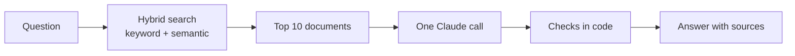

# Technical Knowledge Assistant

    

A command-line assistant that answers LangChain questions from the FreshStack LangChain corpus only, and cites the corpus documents behind every claim.

Built by Max van Eck as a technical case study. The assignment is in [Docs/assignment.md](Docs/assignment.md).

<!-- 1. What is this: Max's own short story comes here -->

## How to start

You need Python 3.13 and [uv](https://docs.astral.sh/uv/).

```bash
# 1. Clone the repo and install the dependencies
git clone https://github.com/m-veck/Technical-Knowledge-Assistant
cd Technical-Knowledge-Assistant
uv sync

# 2. Put the .env file from the email in the repo root (see the note below)

# 3. Download the prebuilt database: the full index, about 700 MB
uv run tka download database

# 4. Ask a question
uv run tka ask "How do I add memory to a LangChain agent?"
```

> [!NOTE]
> The `.env` file holds the Anthropic and Cohere API keys. To use your own keys instead, copy `.env.example` to `.env` and fill them in.
>
> If the download in step 3 fails, get `tka.db` by hand from the [release page](https://github.com/m-veck/Technical-Knowledge-Assistant/releases/tag/index-2026-11-17) and put it at `data/tka.db`.

## More documentation

| Document | What is in it |
|---|---|
| [Docs/assignment.md](Docs/assignment.md) | The assignment |
| [Docs/final-report.md](Docs/final-report.md) | The final report (in Dutch): results, what I think of them, limitations and what to improve |
| [Docs/decisions.md](Docs/decisions.md) | Every decision with its reason (in Dutch) |
| [reports/report-test.html](reports/report-test.html), [reports/report-dev.html](reports/report-dev.html) | The evaluation reports: all numbers, and every question with its answer and verdicts |
| [Docs/command-flows.html](Docs/command-flows.html) | How the `tka` commands fit together: which file each one reads and writes, step by step |
| [Docs/design/answer-prompt.md](Docs/design/answer-prompt.md) | What the system prompt tries to do, and why |
| [Docs/design/hardening.md](Docs/design/hardening.md) | How the assistant deals with odd input, off-topic questions and instructions hidden in documents |
| [Docs/design/judge-prompts.md](Docs/design/judge-prompts.md) | What the two judge prompts try to do, and their known limits |

The HTML files open in a browser from your clone.

## Using it

### Ask a question

```bash
# One question, one answer
uv run tka ask "How do I add memory to a LangChain agent?"

# No question: keep typing questions until you type `exit`
uv run tka ask

# Also show the statements behind the answer, each with its document ids
uv run tka ask "How do I add memory to a LangChain agent?" --details
```

What you get back:

- **The answer**, with markers like `[3]` behind the sentences that rest on a document.
- **Sources**: every retrieved document the answer cites, with its number, its corpus id and its GitHub URL.
- **A status line**: the outcome, the model, the tokens used and the seconds it took.

The outcome is one of four:

| Outcome | Meaning |
|---|---|
| `answered` | The retrieved documents hold an answer; it comes with citations |
| `not_in_corpus` | A question about these libraries, but the retrieved documents do not cover it; it says so and does not guess |
| `out_of_scope` | Not a question for this assistant: another topic, another task, or input it cannot make sense of |
| `about_assistant` | A question about the assistant itself or about what the corpus contains |

> [!NOTE]
> Every question is answered on its own. Follow-up questions do not work, also not in the loop.

### Search the index yourself

`tka search` shows the documents the search finds, without an answer. It is the same search `tka ask` uses.

```bash
uv run tka search "How do I add memory to a LangChain agent?"
uv run tka search "RunnableWithMessageHistory" --mode keyword --k 5
```

`--mode` is `keyword` (BM25), `semantic` (vectors) or `hybrid` (both, the default). `--k` is how many results to show.

### All commands

| Command | What it does |
|---|---|
| `uv run tka ask "question"` | Answer a question from the corpus, with its sources (`--details`, `--model`) |
| `uv run tka search "question"` | Show the top retrieved documents (`--mode`, `--k`) |
| `uv run tka download database` | Download the prebuilt database from the GitHub Release into `data/tka.db` |
| `uv run tka download datasets` | Download the LangChain corpus and queries from Hugging Face into `data/raw/` |
| `uv run tka setup` | Create an empty database with its tables (only to build the index yourself) |
| `uv run tka index` | Embed the corpus rows and store them; continues where the last run stopped (`--limit 100` for a trial) |
| `uv run tka split` | Split the 203 evaluation questions into dev and test (already done, `splits/split.json`) |
| `uv run tka evaluation retrieval` | Measure the search on the evaluation questions |
| `uv run tka evaluation answers` | Answer the evaluation questions and save every answer |
| `uv run tka evaluation judge <answers file>` | Let Claude judge the saved answers |
| `uv run tka report` | Make one HTML report of the saved evaluation runs of a split (`--split dev` or `test`); free, no API calls |

Every command explains itself with `--help`.

## How it works

One search, then one Claude call. No agent loop, no tools, no web search.



1. **Index** (built once, you download it). Every corpus row is one document: 49,505 in total, no extra chunking. Each is embedded once with Cohere `embed-v5.0-pro` and stored in one SQLite file, with a keyword index (FTS5) and a vector index (sqlite-vec) next to each other. The 608 rows that hold only base64 data are stored but not searchable, so 48,897 documents can be found.
2. **Search.** The question goes through keyword search (BM25) and semantic search (vectors). Both score lists are scaled to 0..1 and added up: 0.7 semantic, 0.3 keyword. The top 10 go on.
3. **Answer.** Claude Sonnet 5.5 gets the ten documents and the question, and answers from those documents only. The reply is structured JSON: an outcome, the answer text, and a list of statements with the document ids each one rests on.
4. **Checks.** Code checks every answer: each cited id must be one of the ten retrieved documents, and the markers in the text must match the cited documents. An answer that fails a check says so on screen.
5. **Evaluation.** The 203 FreshStack questions are used for this only; nothing from them is in the index or the prompt. They are split into 68 for tuning (dev) and 135 for the final run (test).

All settings sit in one file: [src/tka/config.py](src/tka/config.py). The system prompt is plain text: [answer-system-prompt.md](src/tka/prompts/answer-system-prompt.md).

## Key decisions

The five choices that shaped the project most. All of them, each with its reason, are in [Docs/decisions.md](Docs/decisions.md) (in Dutch).

1. **One search and one Claude call, no agent loop.** The assignment describes one pass, and this way what is evaluated is exactly what a user gets. A loop that searches again is the next step.
2. **A flat index in one SQLite file.** One embedding per corpus row and no extra chunking: the rows are already pieces of a file, and an LLM reads them. The keyword index (FTS5) and the vectors sit in the same file, so there is no Docker and nothing to host.
3. **Hybrid search: BM25 next to Cohere embeddings.** The questions are full of error messages and exact names, and on the FreshStack leaderboard BM25 beats the OpenAI embedding models on this dataset (alpha-nDCG@10 0.230 against 0.213 and 0.207). Cohere Embed v5.0 Pro scores 0.376 there, the highest of the providers I compared (OpenAI, Voyage, Google, Mistral). The two score lists are added up, 0.7 semantic and 0.3 keyword, tuned on the dev questions only.
4. **A structured answer that code checks.** Claude returns JSON with an outcome, the answer and the document ids behind every statement. Code checks that every cited id was really retrieved, so a wrong source is caught without an LLM.
5. **Tune on 68 questions, test once on 135.** A fixed split (seed 42). The search is scored with the three FreshStack metrics, the answers by a judge of two Claude calls that is kept simple enough to explain.

## Results

The test split (135 questions) was run once, after every setting was final. The dev split (68 questions) is the one the search was tuned on.

| | Test (135 questions) | Dev (68 questions) |
|---|---|---|
| Nuggets with a supporting document in the top 10 | 60% (257 of 431) | 68% (142 of 208) |
| Hybrid search: Recall@50, Coverage@20, alpha-nDCG@10 | 0.47, 0.72 and 0.37 | 0.52, 0.74 and 0.45 |
| Questions answered | 120 of 135 | 65 of 68 |
| Nugget score, strict and lenient | 0.32 and 0.43 | 0.30 and 0.42 |
| Helpful to the person who asked: yes, partly, no | 41, 68 and 11 | 22, 40 and 3 |
| Cited statements backed by their document | 94% (508 of 538) | 95% (290 of 304) |
| Cost and time per answer | $0.06 and 7.8 s | $0.06 and 8.6 s |

A nugget is one fact a good answer must contain. They come with the FreshStack questions, together with the documents that support each one.

Where to read more:

- **[Docs/final-report.md](Docs/final-report.md)** (in Dutch): one good and one poor answer written out, what the numbers say, what worked and what did not, the limitations, and what I would improve next.
- **[reports/report-test.html](reports/report-test.html)** and **[reports/report-dev.html](reports/report-dev.html)**: every number with an explanation of how it is measured, and every question with its answer, the judge's verdicts and their reasons. Filter the question list on "Helpful: yes" or "No" to read good and poor answers. GitHub shows an HTML file as source code, so open these in a browser from your clone.

## Reproduce the evaluation

The evaluation has three parts and a report. Each part writes one JSON file to [results/](results/), and the files of our own runs are committed, so you can read them without paying for a run. The report is made from those files and goes to [reports/](reports/).

```bash
# 0. The evaluation questions (and the corpus) from Hugging Face
uv run tka download datasets

# 1. The search alone: Recall@50, Coverage@20 and alpha-nDCG@10 for keyword, semantic and hybrid
uv run tka evaluation retrieval

# 2. The assistant answers every question; all answers are saved
uv run tka evaluation answers

# 3. Claude judges the saved answers: complete, helpful, backed by their sources?
uv run tka evaluation judge results/answers-dev-<date>-<time>.json

# 4. One HTML page with all the numbers and every question (free, no API calls)
uv run tka report
```

| Part | Dev (68 questions) | Test (135 questions) |
|---|---|---|
| `retrieval` | No cost: the question embeddings are saved in `splits/question_cache.json` | No cost, same file |
| `answers` | $4.20, 8.6 s per question | $8.20, 7.8 s per question |
| `judge` | $2.43, 7.3 s per judged answer | $4.42, 6.9 s per judged answer |
| `report` | Free | Free |

The costs are measured from the token counts of our own runs.

- **Dev or test.** `retrieval` and `answers` run on dev by default. `--split test` runs the final part and asks you to confirm first: it is meant to be run once. `judge` takes the split from the answers file you give it, and `uv run tka report --split test` makes the test report.
- **A trial first.** `--limit 5` runs only the first five questions.
- **Stopped halfway?** `answers` and `judge` save after every question. Continue with `--resume <results file>`.

## Repo layout

```text
README.md                        this file
pyproject.toml, uv.lock          dependencies, and the `tka` command
.env.example                     template for the two API keys

src/tka/
  cli.py                         the `tka` command; every subcommand is a thin wrapper
  config.py                      all paths and settings
  download.py                    fetch the database (GitHub Release) and the datasets (Hugging Face)
  database.py                    the SQLite file: documents, keyword index, vector index
  ingest.py                      build the index: corpus rows, embeddings, database
  embedding.py                   texts to vectors (Cohere)
  retrieval.py                   keyword, semantic and hybrid search
  answer.py                      one search and one Claude call; returns one dict, prints nothing
  ask.py                         the terminal side of `tka ask`
  split.py                       split the questions into dev and test
  evaluation_questions.py        load the questions of a split, keep their embeddings
  evaluation_retrieval.py        the three retrieval metrics
  evaluation_answers.py          run the questions through the assistant, save the answers
  evaluation_judge.py            let Claude judge the saved answers
  evaluation_report.py           collect the numbers of the saved runs for the HTML report
  templates/
    report.html                  the report page; `tka report` fills in the numbers
  prompts/
    answer-system-prompt.md      the system prompt of the assistant
    judge-nuggets-prompt.md      judge call 1: is the answer complete and helpful?
    judge-support-prompt.md      judge call 2: do the cited documents back the answer?

splits/
  split.json                     which question is dev and which is test (seed 42)
  question_cache.json            the embeddings of the evaluation questions

results/                         one JSON file per evaluation run
reports/                         the HTML report of the dev and of the test split
Docs/                            the assignment, the final report, the decisions and the design notes
data/                            the database and the downloaded datasets (not in git)
```
